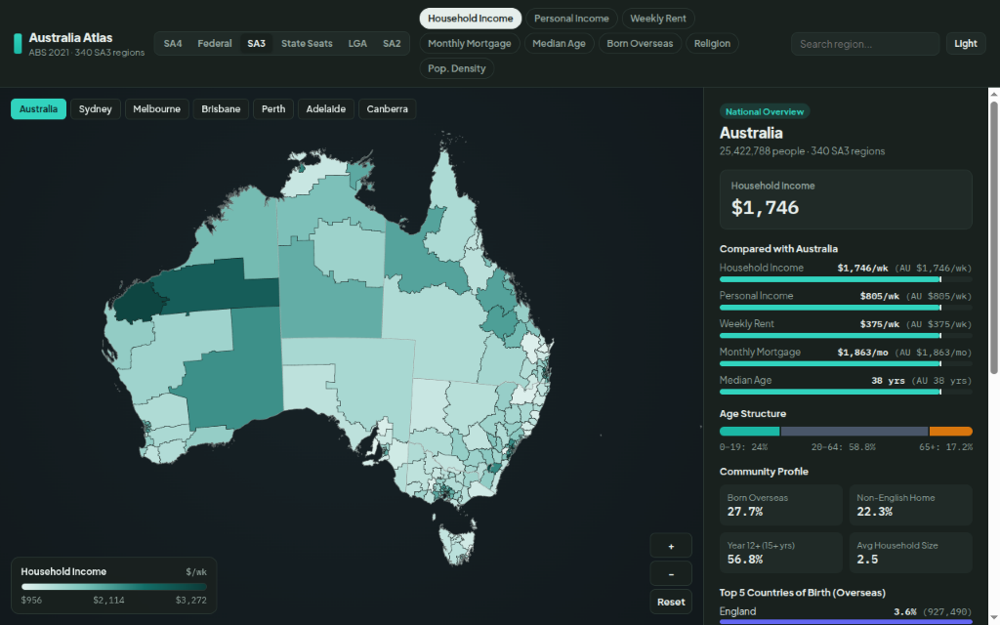

# Australia Census & Election Atlas

**Live Demo:** https://pierrer22.github.io/australia-census-atlas/

Interactive choropleth atlas of Australia combining **ABS 2021 Census** data (`G01`, `G02`, `G09`, `G14`, `G49`) with **2025 AEC Federal** and **410 State/Territory** election results across six geographic layers.



## Features

- **6 Geography Layers (sorted by granularity):**
  - `SA4` (89 Statistical Areas Level 4)
  - `Federal` (150 Commonwealth Electoral Divisions + 2025 AEC 2CP/2PP results)
  - `SA3` (340 Statistical Areas Level 3)
  - `State Seats` (433 State Electoral Divisions + 410 results across NSW 2023, VIC 2022, QLD 2024, WA 2025, SA 2026, NT 2024, TAS 2025)
  - `LGA` (547 Local Government Areas)
  - `Suburbs` (`SA2`, 2,454 suburb-level areas)
- **Grouped Metric Switcher:** 15 lenses organized into `Housing & Income`, `Demographics`, and `Elections & Crime` (auto-switching layers when needed):
  - `Housing & Income`: Household Income, Personal Income, Weekly Rent, Monthly Mortgage, and Household Size.
  - `Demographics`: Median Age, Born Overseas (%), Religion (% Affiliated, excluding Not Stated), Education (% Uni Degree + hover qualification breakdown table), Citizenship (% Aus Citizen), and Population Density.
  - `Elections & Crime`: `2025 Winner` & `2025 ALP 2PP` (`Federal`), `State Winner` (`State Seats`), and `Crime Rate` (`LGA` layer — 12-month rate across 278 LGAs in NSW, VIC, QLD, and NT, ranked within state due to differing police offence definitions and population bases).
- **Interactive Dossier & Shareable URLs:** Click any region, city quick-zoom (`Sydney`, `Melbourne`, `Brisbane`, `Perth`, `Adelaide`, `Canberra`), state/territory quick-zoom (`NSW`–`ACT` with ABS June 2026 Mean Dwelling Price), search result, or leaderboard item, and share the exact view via the URL hash (`#layer=...&metric=...&code=...`).
- **Dynamic Map Labels:** Zoom-responsive region names with boundary-fit and 2D collision avoidance so labels appear cleanly as you zoom in without overlapping text or borders.
- **Dark / Light Mode:** Persisted in `localStorage`.

## Quick Start

All processed GeoJSONs (`web/data/`) and election datasets (`aec/`) are committed in the repository. Serve `web/` locally with any static HTTP server:

```bash
python3 -m http.server 8765 --directory web
```

Then open `http://localhost:8765/`.

## Rebuilding from Raw Sources

Install Python dependencies and ensure ABS 2021 GCP DataPacks and ASGS Edition 3 shapefiles (simplified to `web/data/*.geojson` with `mapshaper`) are present locally, then rebuild and validate:

```bash
pip install -r requirements.txt
python3 scripts/fetch_state_elections.py
python3 scripts/build_crime_data.py
python3 scripts/build_census_data.py
python3 scripts/validate_site.py
```

## Sources

- Australian Bureau of Statistics (ABS) 2021 Census General Community Profile (GCP), ASGS Edition 3 Digital Boundary Files, and *Total Value of Dwellings* (June Quarter 2026)
- Australian Electoral Commission (AEC) 2025 Federal Election Tally Room (`Event 31496`)
- State/Territory Legislative Assembly & House of Assembly election results (NSW 2023, VIC 2022, QLD 2024, WA 2025, SA 2026, NT 2024, TAS 2025)
- State/Territory Crime Data: NSW BOCSAR, Crime Statistics Agency Victoria (CSA), Queensland Police Service (QPS), and NT Police

## License

- **Code (`web/*.{html,css,js}`, `scripts/`, `.github/`):** Licensed under the [MIT License](LICENSE).
- **Data (`web/data/`, `aec/`, `crime/`):** Third-party and derived datasets retain their original licences:
  - **ABS data:** Based on Australian Bureau of Statistics data ([abs.gov.au](https://www.abs.gov.au)), licensed under [CC BY 4.0](https://creativecommons.org/licenses/by/4.0/). ABS data used with permission from the Australian Bureau of Statistics.
  - **AEC federal election data (`aec/House*.csv`):** © Commonwealth of Australia (Australian Electoral Commission), licensed under [CC BY 4.0](https://creativecommons.org/licenses/by/4.0/).
  - **State/Territory election summaries (`aec/state_elections.json`):** Derived from Wikipedia Legislative Assembly / House of Assembly election result tables, licensed under [CC BY-SA 4.0](https://creativecommons.org/licenses/by-sa/4.0/).
  - **Crime datasets (`crime/lga_crime.json`):** Derived from NSW BOCSAR, Crime Statistics Agency Victoria (CSA), Queensland Police Service (QPS), and NT Police open datasets ([CC BY 4.0](https://creativecommons.org/licenses/by/4.0/)).
